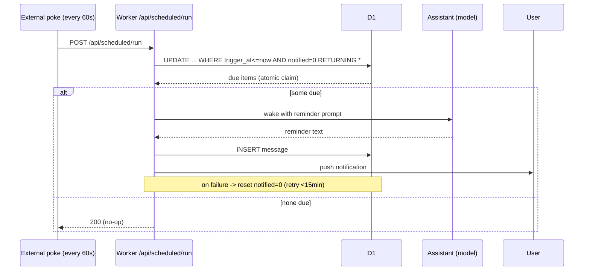

# Checklist with Timed Reminders (Alarm)

A daily to-do list where **any item can carry a one-time timestamp**. When that
time arrives, the backend **wakes your assistant and has it proactively message
the user** — a real alarm, not just a passive due-date badge.

Reference stack: **Cloudflare Workers + D1 (SQLite)**. The design is
backend-agnostic — the only hard requirements are a table, a REST surface, and a
once-a-minute tick that can make an outbound call to your assistant.

> **Audience note.** This document assumes you already have your own frontend.
> The reminder/alarm logic is entirely server-side; your UI only renders the
> list and lets the user check items. A ready-to-adapt reference UI (the
> "receipt" style) ships in [`examples/receipt-checklist.html`](examples/receipt-checklist.html).

---

## 1. Concept: three shapes of an item

One table backs three behaviors, distinguished by two columns (`is_fixed`,
`trigger_at`):

| Shape | `is_fixed` | `trigger_at` | Behavior |
|---|---|---|---|
| **Fixed daily** | `1` | `NULL` | Recurs every day. At local midnight its `done` resets to 0 (the row stays). "Drink water", "review notes". |
| **One-off (no time)** | `0` | `NULL` | A throwaway task for today. Deleted entirely at midnight whether done or not. |
| **Timed reminder (alarm)** | `0` | set | Fires at `trigger_at`: the assistant is woken and messages the user. If **done**, deleted next midnight. If **not done**, kept and surfaced as **overdue**. |

Setting `trigger_at` on an item **forces `is_fixed = 0`** — a timed item is
inherently one-off.

---

## 2. Data model

D1 / SQLite table `checklist`:

```sql
CREATE TABLE checklist (
  id          INTEGER PRIMARY KEY AUTOINCREMENT,
  body        TEXT    NOT NULL,          -- the task text
  is_fixed    INTEGER NOT NULL DEFAULT 1,-- 1 = recurring daily, 0 = one-off
  done        INTEGER NOT NULL DEFAULT 0,-- 0/1
  done_at     INTEGER,                   -- ms epoch when checked, else NULL
  position    INTEGER NOT NULL DEFAULT 0,-- sort order within its is_fixed group
  created_by  TEXT    NOT NULL DEFAULT 'user', -- who added it: 'user' | 'assistant'
  trigger_at  INTEGER,                   -- ms epoch alarm time; NULL = no alarm
  notified    INTEGER NOT NULL DEFAULT 0,-- 1 once the alarm has fired (dedupe guard)
  created_at  INTEGER NOT NULL,
  updated_at  INTEGER NOT NULL
);
```

- **`created_by`** — free-form actor tag. The reference system uses two roles
  ("user" and "assistant") so the UI can label items the assistant added.
- **`notified`** — set to 1 the instant an alarm is claimed for firing; it is a
  *dedupe guard only*. Overdue display does **not** depend on it (see §6) — it
  is computed live from `trigger_at <= now`.

---

## 3. Time input: three ways to say "when"

Clients should not have to compute a 13-digit millisecond epoch. A create/patch
payload may carry **one** of:

| Field | Example | Meaning |
|---|---|---|
| `trigger_at` | `1783618568081` | Absolute ms epoch. |
| `at` | `"07:00"` | Local `HH:MM` **today**; if already past, **tomorrow**. |
| `in` | `30` | `N` minutes from now. |

Resolution precedence (`trigger_at` > `in` > `at`):

```js
// tz-aware "HH:MM local -> ms epoch" (example uses a fixed UTC+8 offset)
function localEpochForHHMM(hh, mm, tzOffsetHours = 8) {
  const p = new Intl.DateTimeFormat("en-CA", {
    timeZone: "Asia/Shanghai", year: "numeric", month: "2-digit", day: "2-digit",
  }).formatToParts(new Date());
  const o = {}; for (const x of p) if (x.type !== "literal") o[x.type] = x.value;
  let ms = Date.UTC(+o.year, +o.month - 1, +o.day, hh, mm) - tzOffsetHours * 3600e3;
  if (ms <= Date.now()) ms += 86_400_000; // already past -> tomorrow
  return ms;
}

function resolveTriggerAt(o) {
  if (o.trigger_at != null) {
    const n = Number(o.trigger_at);
    return Number.isFinite(n) && n > 0 ? Math.floor(n) : null;
  }
  if (o.in != null) {
    const n = Number(o.in);
    if (Number.isFinite(n) && n > 0) return Date.now() + Math.floor(n) * 60_000;
  }
  if (typeof o.at === "string") {
    const m = o.at.trim().match(/^(\d{1,2}):(\d{2})$/);
    if (m) {
      const hh = +m[1], mm = +m[2];
      if (hh < 24 && mm < 60) return localEpochForHHMM(hh, mm);
    }
  }
  return null;
}
```

> ⚠️ **Timezone — read this before you ship.** This reference resolves `at`
> (and the "midnight" of the daily reset in §7) against a **single hardcoded
> zone, `Asia/Shanghai` / UTC+8**. Everything time-related keys off that one
> offset. If your users are elsewhere, change the `timeZone` string in
> `localEpochForHHMM` **and** the reset logic to your zone — otherwise
> `at:"07:00"` fires at 07:00 Beijing, not 07:00 for your user. Also note: the
> backend computes times in this fixed zone, while the reference **frontend**
> renders badges in the *browser's* local zone — keep them the same zone or the
> displayed time and the fired time can disagree.

---

## 4. REST API

Base path `/api/checklist`. All bodies are JSON; all responses are JSON.

| Method | Path | Purpose |
|---|---|---|
| `GET` | `/api/checklist` | List all items (see §7 for ordering). |
| `POST` | `/api/checklist` | Create an item. |
| `PATCH` | `/api/checklist/:id` | Edit body / flags / time. |
| `DELETE` | `/api/checklist/:id` | Delete an item. |
| `POST` | `/api/checklist/:id/toggle` | Toggle (or set) `done`. |

**Create** — `POST /api/checklist`

```jsonc
// request
{ "body": "wake me up", "created_by": "assistant", "at": "07:00" }
// -> is_fixed auto-set to 0 because a time was given
```
```jsonc
// response (the created row)
{ "id": 42, "body": "wake me up", "is_fixed": 0, "done": 0, "position": 3,
  "created_by": "assistant", "trigger_at": 1783696800000, "notified": 0,
  "created_at": 1783610000000, "updated_at": 1783610000000 }
```

A create/patch that carries `trigger_at`/`at`/`in` but resolves to nothing
returns `400 { "error": "..." }`.

**Patch** — any subset of `{ body, is_fixed, created_by, trigger_at|at|in }`.
Passing `trigger_at: null` clears the alarm but **does not touch `is_fixed`** —
so an item that was auto-set to `is_fixed=0` (because it once had a time) stays a
one-off and gets deleted at the next midnight. To turn a timed item back into a
recurring daily item, pass `{ "trigger_at": null, "is_fixed": 1 }` together.
Changing the time resets `notified` to 0 so it can fire again.

**Toggle** — `POST /api/checklist/:id/toggle`, optional body `{ "done": 0|1 }`
(omit to flip). Sets `done_at` accordingly. Returns `{ "ok": true, "done": 0|1 }`.

> 🔒 **Auth — none of this is public.** These endpoints ship with **no**
> authentication in the spec; that is your job. Gate every `/api/checklist*`
> route behind your app's user auth (otherwise anyone can read/edit the list).
> And protect the tick endpoint from §5 (`/api/scheduled/run`) with a shared
> secret so only your poke process can call it — an open one lets anyone spam
> assistant wake-ups (cost + a notification-spam vector).

---

## 5. The alarm pipeline

This is the part that turns a timestamp into a push. Two functions:

**`checkReminders()`** — runs on every tick. Atomically *claims* the items whose
time has arrived, so concurrent ticks can never fire the same alarm twice:

```js
async function checkReminders(env) {
  const t = Date.now();
  // UPDATE ... RETURNING = atomic claim. A second concurrent tick's UPDATE
  // matches 0 rows (already notified) and returns nothing.
  const claimed = await env.DB.prepare(
    `UPDATE checklist SET notified = 1, updated_at = ?
       WHERE trigger_at IS NOT NULL AND trigger_at <= ? AND notified = 0 AND done = 0
     RETURNING id, body, trigger_at, created_by`
  ).bind(t, t).all();
  const due = claimed?.results || [];
  if (!due.length) return 0;
  await fireReminderProactive(env, due); // wake the assistant
  return due.length;
}
```

**`fireReminderProactive(items)`** — wakes the assistant with a reminder prompt
and lets it write the message the user receives. Key properties:

1. **It bypasses the normal "proactive message" throttles.** A reminder is a
   hard time the user set, so it fires even if the user just spoke, even if the
   system thinks the user is asleep, even if generic proactive messaging is
   paused. The *only* things that stop it are (a) the backend not being
   configured and (b) an active rate-limit backoff.
2. **On failure it un-claims for retry.** If the wake throws, or the model
   returns nothing (dropped stream), the claimed items are reset to
   `notified = 0` so the next tick retries — but only within a short window
   (e.g. 15 min past `trigger_at`) to avoid an infinite loop on persistent
   failure. Past the window the item simply remains as "overdue" in the list.

```js
async function fireReminderProactive(env, items) {
  const RETRY_WINDOW_MS = 15 * 60_000;
  const unclaim = async () => {
    const t = Date.now();
    const ids = items.filter(it => it.trigger_at > t - RETRY_WINDOW_MS).map(it => it.id);
    if (ids.length) await env.DB.prepare(
      `UPDATE checklist SET notified = 0 WHERE id IN (${ids.map(() => "?").join(",")})`
    ).bind(...ids).run();
  };

  const list = items.map(it => `- ${it.body} (${fmtLocal(it.trigger_at)})`).join("\n");
  const prompt =
    `These checklist items just came due — remind the user now, in your own voice:\n${list}`;

  let text = "";
  try {
    text = await wakeAssistant(env, prompt);      // your model call
  } catch (e) {
    await unclaim();                              // transient failure -> retry
    return;
  }
  const delivered = await deliverMessage(env, text); // save + push to the user
  if (!delivered && !text.trim()) await unclaim();   // empty/dropped -> retry
}
```

### Where to run the tick — this matters

The tick itself is cheap (one indexed `SELECT`/`UPDATE`). But *firing* an alarm
makes a slow (~tens of seconds) outbound call to your model. **Do not run that
inside a CPU-metered cron** (e.g. Cloudflare's scheduled `cron` on the free
plan) — it will hit the CPU ceiling and get killed mid-wake.

The reference deployment runs the tick from an **external 60-second poke**: a
tiny always-on process (a `launchd`/systemd timer, a separate always-on box,
`cron` + `curl`, etc.) that `POST`s an `/api/scheduled/run` endpoint every 60s.
That request is a normal HTTP invocation with a full time/CPU budget.



---

## 6. Overdue display

An item is **overdue** when `trigger_at <= now && !done`. This is computed live
in the client (and in any server-side "what's on the list" summary) — it does
**not** read `notified`. So an alarm that has fired but wasn't completed keeps
showing as overdue until the user checks it or the day rolls over.

---

## 7. Daily reset (auto-clear)

At the first tick after local midnight, run once:

```sql
-- fixed daily items: un-check (row stays)
UPDATE checklist SET done = 0, done_at = NULL, updated_at = :now
  WHERE is_fixed = 1 AND done = 1;

-- one-off items: delete — BUT keep un-finished timed reminders as "overdue"
DELETE FROM checklist
  WHERE is_fixed = 0 AND (trigger_at IS NULL OR done = 1);
```

Net effect on a **timed reminder**:

- checked (`done = 1`) → **deleted next midnight** (self-cleaning; no manual delete needed)
- unchecked (`done = 0`) → **kept**, still overdue, still nags

"Local midnight" here means **the same fixed zone as §3 (UTC+8 in this
reference)** — change it together with the `at` parser if your users are
elsewhere.

Guard the reset so it runs at most once per day, using a tiny key-value
`settings` table:

```sql
CREATE TABLE settings (
  k TEXT PRIMARY KEY,
  v TEXT
);
-- before running the reset: read settings where k='checklist_last_reset';
-- if v already == today's 'YYYY-MM-DD', skip. Otherwise run the reset, then:
-- INSERT OR REPLACE INTO settings (k, v) VALUES ('checklist_last_reset', :today);
```

(The same `settings` table is a handy place for the other cross-request flags
this system needs — e.g. the `proactive_paused` toggle mentioned in §5.)

---

## 8. Bring-your-own-frontend checklist

To integrate with your own UI you implement, server-side:

1. The `checklist` table (§2).
2. The five REST endpoints (§4) including `resolveTriggerAt` (§3).
3. The once-a-minute tick (§5), fired from a budget-safe context (§5).
4. The daily reset (§7).
5. A `wakeAssistant()` + `deliverMessage()` pair — however your assistant
   produces and delivers a proactive message.

Your frontend then only needs to:

- `GET /api/checklist` and render rows;
- show a **time badge** when `trigger_at` is set (and an **overdue** style when
  `trigger_at <= now && !done`);
- call `toggle` / `POST` / `PATCH` / `DELETE` on user actions.

The render contract per item: `body`, `done`, `trigger_at`, `created_by`,
`is_fixed`. That is all the reference UI reads.

See [`examples/receipt-checklist.html`](examples/receipt-checklist.html) for a
self-contained, themeable implementation (open it directly in a browser — it
ships with mock data and marks every spot where a real API call goes).
